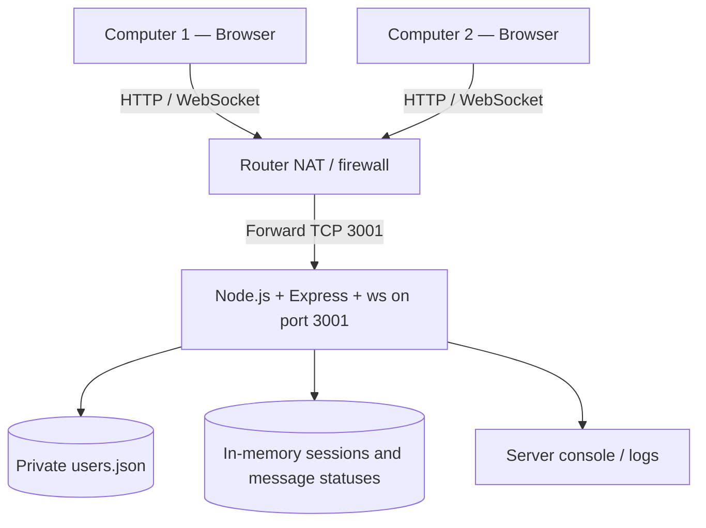

# Client–Server Messaging Simulation — Implementation and Deployment Plan

**Version:** 1.2 — Windows + VS Code; direct Node.js on TCP 3001; no configured session secret  
**Purpose:** Build and deploy a two-client browser messaging application that demonstrates authentication, a central TCP server, bidirectional WebSocket messaging, delivery/read acknowledgements, console logs, and access across a router using NAT.  
**Status:** Proposed plan; implementation and deployment have not yet been performed.

## 1. Objective and acceptance criteria

Deploy one central Node.js server and permit **Computer 1** and **Computer 2** to sign in from separate browsers/computers using credentials defined in a server-side JSON file. The users must be able to send short messages in both directions without refreshing, while the server logs each message and its acknowledgements.

The deployment is successful when all of the following are demonstrated:

- Both identities authenticate with the correct credentials; incorrect credentials are rejected.
- Each browser displays only the identity assigned by the authenticated server session.
- Only one active WebSocket connection is permitted per identity.
- Computer 1 can send to Computer 2; Computer 2 can send to Computer 1.
- The sender receives distinct **SENT**, **DELIVERED**, and **READ** confirmations.
- The physical server's VS Code terminal records authentication, connections, messages, delivery acknowledgements, reading acknowledgements, and disconnects.
- A second computer on the LAN can connect using the server's private IP address.
- An external computer on a different network can connect through an actual router NAT/port-forwarding rule and demonstrate message exchange through the actual forwarded port.
- Disconnected recipients are treated as unavailable; **no offline message queue** is required in version 1.

## 2. Architecture




**Communication rule:** Clients communicate *through the server*, not directly with one another. HTTP serves the login/chat pages and handles login; WebSocket maintains bidirectional communication and acknowledgements. The same Node.js listening port (`3001`) handles both HTTP and WebSocket upgrades. Router NAT forwards directly to Node.js: no intermediary server is needed.

| Part | Selected technology | Role |
|---|---|---|
| Application server | Node.js (supported LTS) + Express | Serve frontend, authenticate users, expose API |
| Realtime channel | `ws` WebSocket library | Maintain authenticated connections, route messages and ACKs |
| Frontend | HTML, CSS, vanilla JavaScript | Login, chat, connection status, delivery/read status |
| Credential source | `users.json` outside `public/` | Two usernames and *hashed* passwords |
| Session management | In-memory session registry + opaque random ID in an HttpOnly cookie | Bind browser and WebSocket identity to the authenticated user; no configured signing key |
| Execution environment | Windows + VS Code integrated PowerShell terminal | Run Node.js directly and display server logs |
| Router | Destination NAT / port forwarding | Forward external TCP 3001 directly to Node.js |

**Server host:** The Windows computer running the project from VS Code, on the router's LAN with a reserved IP address. Example IPs and hostnames in this plan are placeholders; replace them with actual deployment values.

## 3. Project layout

```text
client-server-simulation/
├── server.js                 # HTTP server, app bootstrap
├── package.json
├── package-lock.json
├── users.json                # PRIVATE; no browser access
├── .env.example              # Configuration template; no secrets
├── .gitignore
├── services/
│   ├── auth.js               # Credential validation and session identity
│   ├── websocket.js          # Connections, routing and acknowledgements
│   └── messages.js           # Message validation and status lifecycle
├── public/
│   ├── index.html            # Login
│   ├── chat.html             # Messaging UI
│   ├── css/styles.css
│   └── js/
│       ├── login.js
│       └── chat.js
└── tests/                    # Automated unit and integration tests
```

Keep `users.json`, `.env`, logs, and server code **outside the public static directory**. The browser never downloads or validates the credential file itself.

## 4. Functional and state rules

### 4.1 Client lifecycle

```text
DISCONNECTED → LOADING_LOGIN → AUTHENTICATING
  ├─ Invalid credentials → LOGIN_ERROR → LOADING_LOGIN
  └─ Valid credentials → AUTHENTICATED → CONNECTING_WEBSOCKET
       ├─ Connection succeeds → CONNECTED → CHAT_READY
       └─ Connection fails → CONNECTION_ERROR → RETRY_OR_LOGOUT

CHAT_READY → NETWORK_LOST → RECONNECTING
  ├─ Session remains valid → CHAT_READY
  └─ Session expired/revoked → LOADING_LOGIN

CHAT_READY → LOGOUT → DISCONNECTED
```

- An authenticated identity is assigned by the server (`computer1` or `computer2`) and must never be trusted from a browser-supplied `from` field.
- Reject a second active connection for the same identity, including a second browser tab. Release the identity when the connection closes or a heartbeat determines it is stale.
- Reconnection requires the existing session to remain valid. Expired sessions return to the login page.
- Each browser shows connection status and whether the other computer is online.

### 4.2 Message lifecycle

```text
COMPOSING → SUBMITTED → VALIDATING
  ├─ Invalid / empty / too long → REJECTED
  └─ Valid → ACCEPTED_BY_SERVER (SENT)
       ├─ Destination offline → UNDELIVERABLE
       └─ Destination online → FORWARDED
            ├─ No delivery ACK before timeout → DELIVERY_UNCONFIRMED
            └─ Recipient's delivery ACK → DELIVERED
                 └─ Recipient explicitly views/marks read → READ
```

- **SENT** means the server accepted the message, **not** that the recipient received it.
- **DELIVERED** requires an acknowledgement returned by the receiving browser after processing the incoming message.
- **READ** requires a separate acknowledgement after the message is displayed in a visible chat, or after an explicit *Mark as read* action. For the strongest classroom demonstration, use the explicit button.
- Delivery and read ACKs must include a `messageId`; the server verifies the acknowledgement came from the intended recipient.
- Reject forged, duplicate, invalid, or unauthorized acknowledgements; log unexpected events.
- The backend logs state changes, not fabricated examples of a successful delivery.
- Store messages and statuses in memory for this version; state is lost on restart. Persistence can be added later.

### 4.3 Example event contract

A client requests to send:

```json
{"type":"message","to":"computer2","content":"Hello Computer 2"}
```

The server creates the message ID, determines the authenticated `from`, and forwards the message. The recipient acknowledges with events of the following shape:

```json
{"type":"delivered","messageId":"MSG-001"}
```

```json
{"type":"read","messageId":"MSG-001"}
```

The server forwards confirmed status changes to the sender. The example ID above is illustrative; real IDs must be unique. Use acknowledgements and timeouts rather than treating WebSocket `send()` completion as proof of delivery.

## 5. Implementation phases

| Phase | Work | Deliverable | Exit check |
|---|---|---|---|
| P0 — Prepare | Prepare Windows host, reserve IP, install supported Node.js LTS and VS Code | Prepared environment | Host reachable on LAN |
| P1 — HTTP | Start Express app on configurable host/port; serve login page | Running HTTP server | Browser opens login page |
| P2 — Authentication | Create two users in private JSON; hash passwords; implement login and in-memory sessions without a configured signing key | Working login | Correct login accepted, bad login rejected |
| P3 — Realtime | Upgrade authenticated sessions to WebSockets; track both identities | Connected-client registry | Server recognizes both clients and prevents duplicates |
| P4 — Chat | Implement message input, Send button, sender/recipient routing | Two-way chat | Both clients exchange messages without refresh |
| P5 — Acknowledgements | Add server-generated message IDs and SENT/DELIVERED/READ lifecycle | Delivery/read states | Sender sees ACKs and server logs them |
| P6 — Failure handling | Handle unavailable recipient, disconnect, reconnect, invalid frames, duplicate ACKs | Predictable edge cases | No false delivery/read confirmations |
| P7 — LAN deployment | Run on server host, allow required firewall port, test other LAN machine | LAN demo | Both physical clients can access server |
| P8 — NAT | Configure TCP 3001 forwarding, firewall, and external connectivity | External deployment | Remote device connects over public network |
| P9 — Evidence and report | Run acceptance test matrix and gather proof | Complete deployment report | All critical tests passed |

**Dependency:** Complete and verify P1–P6 before exposing the service on the router's WAN side.

## 6. Host and configuration preparation

### 6.1 Host checklist

1. Use the Windows computer as the server and keep it powered on and awake during the demonstration.
2. Install a supported Node.js LTS release, including npm, and Visual Studio Code.
3. Open the project folder in VS Code. Use **Terminal → New Terminal** and select **PowerShell**. Run project commands from the folder containing `server.js` and `package.json`. [1]
4. Verify the installations:

   ```powershell
   node --version
   npm.cmd --version
   ```

5. Reserve a private IPv4 address in the router's DHCP configuration, for example `192.168.1.50`. Confirm the active Windows adapter's IPv4 address with `ipconfig`.
6. Confirm access to Windows Firewall and the router's NAT/firewall settings. Administrator permissions are needed for firewall changes, not for normal application execution.
7. Check that the router has a reachable public WAN address before relying on ordinary port forwarding. Record the actual public IP for the external test; no domain name is required.

The application runs directly from VS Code's terminal. A background service, container, or additional web server is not part of this deployment.

### 6.2 Configuration values

The application will run on **Windows**, from **VS Code's integrated PowerShell terminal**, using port **3001**.

Create `.env.example` in the project root with:

```dotenv
HOST=0.0.0.0
PORT=3001
USERS_FILE=./users.json
MESSAGE_MAX_LENGTH=500
```

For the initial setup, copy the template to `.env`:

```powershell
Copy-Item .env.example .env
```

Use Node.js's built-in environment-file loader when starting the application: [2]

```powershell
node --env-file=.env server.js
```

The server implementation must read these values from `process.env`, validate the numeric port and message limit, and use them when starting the listener and processing messages. Resolve `USERS_FILE` from the project directory.

There is **no `SESSION_SECRET` setting and no manually configured signing key**. The login design uses server-generated random session IDs stored in memory, as specified in section 6.3.

Keep `.env` outside `public/` and add it to `.gitignore` as machine-specific configuration. Do not put user passwords in this file. Keep using disposable credentials for the unencrypted demonstration.

Use `http://localhost:3001` on the server itself. Other computers use `http://SERVER_LAN_IP:3001`, replacing `SERVER_LAN_IP` with the Windows computer's actual IPv4 address. `0.0.0.0` is the listening address, not the address to enter in a client browser.

### 6.3 Credentials

The private JSON file should contain exactly two identities and password hashes, for example:

```json
{
  "users": [
    {"id":"computer1","username":"Computer 1","passwordHash":"<GENERATED_HASH_1>"},
    {"id":"computer2","username":"Computer 2","passwordHash":"<GENERATED_HASH_2>"}
  ]
}
```

Keep credential validation on the server and retain password hashes in the private JSON file. Do not place passwords in client JavaScript or return hashes to a browser.

**Session design without a configured signing key:** After a valid login, generate an unpredictable opaque ID using Node.js `crypto.randomBytes(32).toString('hex')`. Store the mapping from that ID to `computer1` or `computer2` in the server's memory, together with its expiry. Send only the ID in an `HttpOnly; SameSite=Strict; Path=/` session cookie. The ID contains no username or permissions; only the server-side record defines the identity. This uses random session IDs rather than signed tokens. [3][4]

The WebSocket upgrade must check the cookie against the server's session registry and validate the request origin. Unknown, expired, or revoked IDs are rejected. Use a proposed one-hour absolute session lifetime; terminate any associated socket when the session expires or the user logs out. A server restart clears all sessions and requires both users to log in again. Existing sessions may be reused for a network reconnection only while valid. Do not rely on a username supplied by the browser as proof of authentication.

Do not add JWT authentication or middleware that requires a signing secret to this implementation. This is a small, in-memory demonstration, not a production session-management framework. Plain HTTP does not protect credentials or session IDs from interception; the deployment remains restricted to the controlled test described in section 8.

## 7. LAN deployment procedure — Windows and VS Code

**Goal:** Prove the application works on a local network before configuring NAT. These commands apply after the application files and dependency declarations have been implemented.

1. Open the project folder in VS Code and open a PowerShell terminal at the project root.
2. Install the dependencies from the project's lockfile:

   ```powershell
   npm.cmd ci
   ```

   During initial development, if no `package-lock.json` exists yet, use `npm.cmd install` once after defining the dependencies in `package.json`.

3. Confirm `users.json` contains the two users and their valid password hashes. Create `.env` from `.env.example` as shown in section 6.2; do not overwrite an already configured `.env` unnecessarily.
4. Start the server:

   ```powershell
   node --env-file=.env server.js
   ```

5. Confirm the terminal reports `0.0.0.0:3001`, then open `http://localhost:3001` on the server computer. Keep this terminal running so it remains available for clients and shows the real server logs.
6. In a separate **administrator PowerShell** window, create a Windows Firewall rule restricted to the trusted local subnet. The following example assumes the server's trusted LAN connection uses the **Private** firewall profile: [5]

   ```powershell
   New-NetFirewallRule -Name "ClientServer-LAN-3001" -DisplayName "Client-server simulation LAN TCP 3001" -Direction Inbound -Protocol TCP -LocalPort 3001 -RemoteAddress LocalSubnet -Profile Private -Action Allow
   ```

   Check the active network profile in Windows network settings before using this rule. Do not disable Windows Firewall. A rule restricted to `LocalSubnet` does not permit the external NAT test; section 8 requires a separate allowance for the external test source.

7. On both client computers, open `http://192.168.1.50:3001`, replacing the sample IP with the server's actual LAN address.
8. Log in separately as Computer 1 and Computer 2. Send messages both ways and verify SENT, DELIVERED, and READ in the sender's browser and the server terminal.
9. Save screenshots of both browsers and the server terminal for the report.

**LAN exit condition:** Both physical computers can log in independently, exchange messages, and show actual delivery/read acknowledgements. Continue to external deployment only after this succeeds.

## 8. External deployment: direct NAT to Node.js

### 8.1 Direct connection topology

```text
Computer on a different network
   → http://PUBLIC_IP:3001
   → Router public WAN IP, TCP 3001
   → Destination NAT: TCP 3001 → 192.168.1.50:3001
   → Node.js listening on 0.0.0.0:3001
   → HTTP login / authenticated WebSocket communication
```

**Illustrative NAT rule:**

| Setting | Value |
|---|---|
| Chain / type | Destination NAT / port forward |
| Incoming interface | WAN |
| Protocol | TCP |
| Public port | `3001` |
| Internal host | `192.168.1.50` (example; replace with actual server IP) |
| Internal port | `3001` |
| Action | Forward to the Node.js server |

Windows Firewall must also permit TCP `3001` from the external test client's public IP. The LAN-only rule from section 7 is not enough. In **Windows Defender Firewall with Advanced Security**, create a separate inbound TCP rule for local port `3001`, scope its remote address to that test client's actual public IP, and enable it for the server's active trusted network profile. Remove or disable this temporary rule after testing. [5]

Also confirm the router's forwarding firewall permits the connection; a NAT rule does not itself override a firewall drop.

### 8.2 External test procedure

1. Confirm Node.js is listening on the LAN-accessible interface and port `3001`.
2. Confirm the server has a stable LAN IP address.
3. Create the router's TCP port-forwarding rule to the server's LAN IP and port `3001`.
4. Confirm the server and router firewall rules permit the connection.
5. From a truly external Internet connection, open `http://PUBLIC_IP:3001` using a disposable test account.
6. Authenticate as one computer while the other computer is connected; exchange messages both ways.
7. Verify actual SENT, DELIVERED, and READ acknowledgements in the sender's browser and the server console.
8. Capture the NAT rule, both client windows, and server logs for the report.
9. Disable the public forwarding rule after the assessment, unless a secure deployment is separately implemented.

**Security boundary:** This direct HTTP configuration is for an isolated, short-lived classroom simulation using throwaway passwords. HTTP and ordinary WebSockets do **not** encrypt login credentials or messages. Do not leave this exposed on the public Internet or use real credentials. If encrypted public access becomes a requirement, Node.js can be configured for HTTPS/WSS directly, using an appropriate certificate, without changing the single-server architecture.

### 8.3 Network restrictions and failure cases

- If the WAN address is private or carrier-grade, **CGNAT** may prevent inbound forwarding. A public reachable IP (or ISP assistance) is required for a genuine NAT demonstration.
- Verify that the server is listening, the host firewall permits the traffic, and the router forwarding rule targets the correct IP and port.
- Test from a genuinely different network. Connecting to your public IP from inside the LAN may not work when the router lacks NAT loopback.
- If an ISP blocks TCP `3001`, document the restriction and arrange an allowed external port; it can still forward to the server's internal TCP `3001`.
- A tunnel or VPN can provide remote access but does not prove that the router NAT rule worked.

## 9. Running the demonstration and checking logs

Run Node.js directly in the **VS Code PowerShell terminal**. Keep the server process running throughout the demonstration; this plan does not install an automatic-restart service.

```powershell
node --env-file=.env server.js
```

To stop the application, focus its terminal and press **Ctrl+C**. To restart it, run the same command again. Configure the application's shutdown handler to close active WebSockets and the HTTP listener. A restart clears the in-memory sessions and message history, so both users must log in again.

At startup, log configuration loading, the listening address, and readiness. Authentication, messages, acknowledgements, and disconnects must appear in this same terminal.

Example **expected log format**, not fabricated test evidence:

```text
[SERVER] Listening on 0.0.0.0:3001
[AUTH] computer1 authenticated
[WS] computer1 connected
[AUTH] computer2 authenticated
[WS] computer2 connected
[MSG] MSG-001 from=computer1 to=computer2 status=SENT
[ACK] MSG-001 from=computer2 status=DELIVERED
[ACK] MSG-001 from=computer2 status=READ
[WS] computer2 disconnected
```

Do not log passwords, session IDs, cookies, or password hashes. For the exercise, record the identity, timestamp, message ID, destination, short test message, and acknowledgement status.

## 10. Test matrix and required evidence

| ID | Test | Pass condition | Evidence to capture |
|---|---|---|---|
| T01 | Start server | Node.js listening, no startup error | Console screenshot |
| T02 | LAN page access | Both computers load login page | Browser + LAN IP |
| T03 | Correct credentials (both users) | Assigned identities are correct | Two logged-in screens |
| T04 | Incorrect password | Login denied; no WebSocket session | Login error + server log |
| T05 | Duplicate identity | Second active connection rejected | Error + connection log |
| T06 | Computer 1 → Computer 2 | Message displays at recipient | Both browser views |
| T07 | Computer 2 → Computer 1 | Reply displays at recipient | Both browser views |
| T08 | SENT acknowledgement | Server accepts message, sender sees SENT | Console + sender view |
| T09 | DELIVERED acknowledgement | Recipient browser ACK received by server | Console + sender view |
| T10 | READ acknowledgement | Intended recipient sends read ACK | Console + sender view |
| T11 | Recipient disconnected | Message is UNDELIVERABLE, not READ | Sender view + disconnect log |
| T12 | Abrupt socket failure | Stale connection released, retry is possible | Disconnect/reconnect log |
| T13 | Malformed frame / spoofed sender | Server rejects invalid or impersonated data | Rejection log |
| T14 | NAT rule | Public port reaches Node.js listener | Router rule screenshot |
| T15 | Public network | Different-network client signs in and chats | External browser + server logs |
| T16 | WAN-to-LAN forwarding | External HTTP and WebSocket traffic reach TCP 3001 | Router + server log |

**Evidence rule:** All claims of delivery and reading must be corroborated by real acknowledgements in the server logs. A screenshot of a displayed message alone does not prove that the read ACK reached the server.

## 11. Deployment report outline

1. **Objective and scope:** What the simulation must demonstrate.
2. **Hardware/network:** Server computer, two clients, router, private addressing and WAN topology (redact public IP if sharing report widely).
3. **Technology choices:** Node.js, Express, JSON, browser JavaScript, WebSockets and NAT.
4. **Architecture and state diagrams:** Attach the four project diagrams and ensure their labels match this Windows/TCP 3001 plan.
5. **Implementation:** Server structure, credential handling, routing, ACK state changes.
6. **LAN tests:** IP, port, login results, two-way messages, console evidence.
7. **NAT deployment:** Actual TCP 3001 forwarding rule and firewall configuration.
8. **External tests:** Results from a genuinely different network.
9. **Failures and corrections:** Invalid logins, disconnected recipients, connection loss and any networking blockers.
10. **Conclusions:** Requirements met, limitations, and possible future enhancements.

## 12. Companion design diagrams

The project has four design diagrams: complete application flow, client states, message states, and server lifecycle. The existing editable source is `client_server_network_full_state_flow.drawio`.

This revision updates the Markdown plan only. Before submitting earlier diagram files or images, align any port labels with **3001** and any deployment labels with **Windows / VS Code**. Authentication remains HTTP login followed by a session-validated WebSocket connection; the session registry uses opaque random IDs rather than a configured signing key.

## 13. Explicit limits of version 1

- Exactly two predefined authenticated identities.
- One active socket per identity; no multiple-device support.
- Short text messages only; no files, images, groups, or broadcast messaging.
- No database, durable chat history, or offline delivery queue.
- In-memory statuses reset after server restart.
- Reading is an application-level acknowledgement, not proof of a human actually comprehending the message.
- NAT and Internet connectivity depend on router permissions, ISP addressability and applicable firewalls.

## 14. Completion checklist

- [ ] Application starts from VS Code on Windows and listens on TCP 3001.
- [ ] Credentials load from private JSON and passwords are hashed.
- [ ] Computer identities are bound to server-side in-memory sessions; no configured signing secret is needed.
- [ ] WebSocket connection checks session and origin.
- [ ] Two-way messaging works with unique message IDs.
- [ ] SENT / DELIVERED / READ / UNDELIVERABLE behave correctly.
- [ ] Duplicate login, malformed frames, and disconnects are handled.
- [ ] LAN connectivity passes on two real client machines.
- [ ] External test reaches Node.js directly through forwarded TCP 3001 using disposable credentials.
- [ ] Router NAT and firewall rules are documented with actual values.
- [ ] An external-network client exchanges messages through the router.
- [ ] Test matrix is completed and supported by genuine screenshots/logs.
- [ ] Editable diagrams and deployment report are included in submission.

---

**Recommended execution order:** Build and test locally → validate the two-client flow on the LAN → configure router NAT (TCP 3001) and firewalls → verify from an external network → capture real evidence and compile the report.


## Technical references for the Windows revision

[1] Visual Studio Code documentation — Terminal Basics: <https://code.visualstudio.com/docs/terminal/basics>.

[2] Node.js documentation — Command-line API, `--env-file`: <https://nodejs.org/api/cli.html#--env-filefile>.

[3] Node.js documentation — `crypto.randomBytes`: <https://nodejs.org/api/crypto.html#cryptorandombytessize-callback>.

[4] OWASP — Session Management Cheat Sheet, opaque identifiers and server-side session state: <https://cheatsheetseries.owasp.org/cheatsheets/Session_Management_Cheat_Sheet.html>.

[5] Microsoft Learn — `New-NetFirewallRule`, port, remote-address, and profile parameters: <https://learn.microsoft.com/en-us/powershell/module/netsecurity/new-netfirewallrule>.
